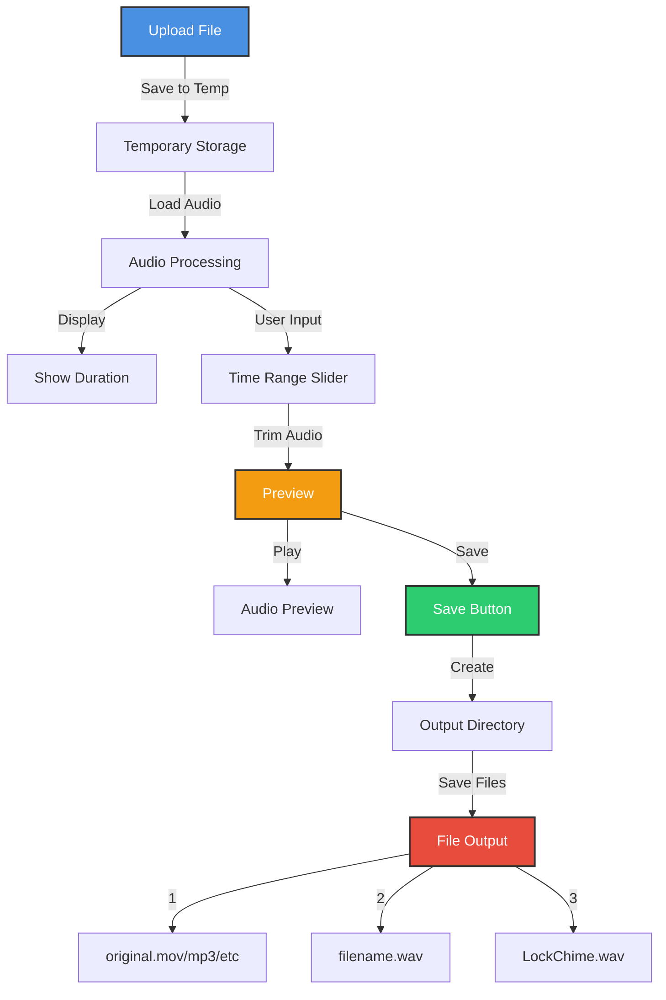

# Vehicle Custom Sound Processor 🔊

A web application built with Streamlit to easily create custom lock chime sound files for vehicles from various audio or video sources.

---

## 📄 Overview

This tool provides a simple interface to:

1. Upload audio or video files (supports `.mp3`, `.wav`, `.mov`, `.mp4`, `.m4a`).
2. Visually trim the audio/video to select the desired segment (defaults to the first 3 seconds).
3. Preview the trimmed audio clip.
4. Save the trimmed clip in the common `LockChime.wav` format, along with the original file and a named `.wav` version, organized into subdirectories within `custom_sounds/`.

---

## ✨ Features

- **Web-Based UI:** Easy-to-use interface powered by Streamlit.
- **Multiple Format Support:** Handles common audio and video formats thanks to `pydub` and `ffmpeg`.
- **Audio Trimming:** Interactive slider for precise start and end point selection.
- **Instant Preview:** Listen to the trimmed audio before saving.
- **Organized Output:** Automatically creates dedicated folders for each sound, storing the original and processed files.
- **Vehicle Ready:** Outputs a common lock chime format (`LockChime.wav`).

---

## 📊 Architecture

### Flow Diagram



### Process Description

**File Upload**
- User uploads audio/video file through Streamlit interface.
- Supported formats: `.mp3`, `.wav`, `.mov`, `.mp4`, `.m4a`.

**Temporary Storage**
- File is temporarily stored for processing.
- Uses Python's `tempfile` module.

**Audio Processing**
- Loads audio via `pydub`.
- Displays file duration.
- Provides slider interface for trimming.

**Preview System**
- Creates temporary WAV for preview.
- Allows verification of trim points.
- Provides audio playback.

**File Output**
- Creates unique subdirectory in `custom_sounds/`.
- Saves three files:
  - Original file
  - Trimmed WAV with original filename
  - Common lock chime `LockChime.wav`

---

## 📝 Prerequisites

- **Python**: Version 3.10+
- **uv**: Used for dependency management. [uv GitHub](https://github.com/astral-sh/uv)
- **ffmpeg**: Required by `pydub` for audio processing.

### ffmpeg Installation

**macOS (Homebrew)**
```bash
brew install ffmpeg
```
*Automatically detected at `/opt/homebrew/bin/ffmpeg`*

**Debian/Ubuntu**
```bash
sudo apt update && sudo apt install ffmpeg
```

**Windows**
- Download from: [https://ffmpeg.org/download.html](https://ffmpeg.org/download.html)
- Ensure `ffmpeg.exe` is in system `PATH`

---

## 📚 Installation

Clone the repository:
```bash
git clone <your-repository-url>
cd tesla_sounds
```

Sync environment using `uv`:
```bash
uv sync
```

Add dependencies (optional):
```bash
uv add <package-name>
```

---

## 🚀 Usage

Ensure `ffmpeg` is installed and accessible.

Run the app:
```bash
uv run streamlit run app.py
```

Open the provided local URL (e.g., `http://localhost:8501`) in your browser.

### Using the App

1. Click "Browse files" to upload an audio/video file.
2. Use the slider to set start/end times.
3. Preview the selection.
4. Click "Save as Lock Sound".

### Output Example
For upload `my_sound.mp4`:
```
custom_sounds/
└── my_sound/
    ├── LockChime.wav
    ├── my_sound.wav
    └── original.mp4
```

**Note:**
- Base output path is hardcoded as `/Users/pergolicious/Scripts/tesla_sounds` in `create_output_directory` (in `app.py`). Adjust as needed for other environments.

---

## 📂 File Structure
```
.
├── .gitignore
├── app.py
├── assets/
│   └── ...
├── custom_sounds/
│   └── ...
├── uv.lock
├── pyproject.toml
└── README.md
```

---

## 👥 Contributing

Contributions welcome! Please open a pull request or issue to contribute ideas, fixes, or enhancements.
